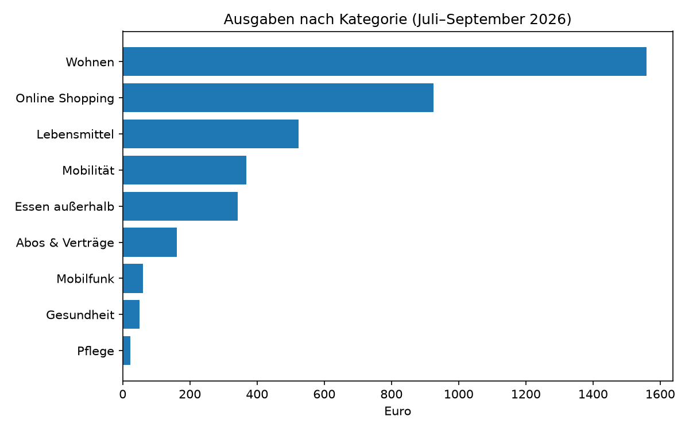
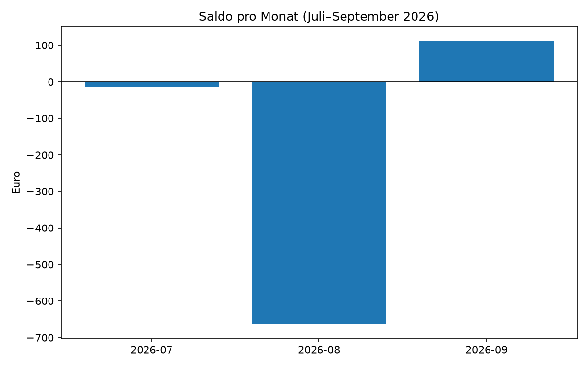
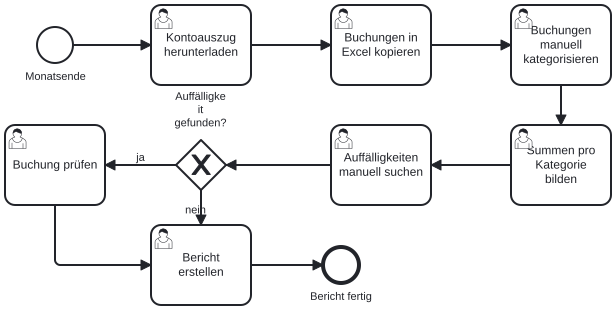
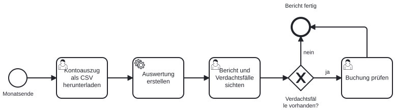

# Finance Automation

Automatisierte Auswertung von Kontoauszügen mit Python: Buchungen einlesen, automatisch kategorisieren, Auffälligkeiten erkennen sowie Diagramme und einen Excel-Bericht erzeugen.

> **Status:** abgeschlossen – Entwicklungsverlauf im [Entwicklungstagebuch](DEVLOG.md)

## Problem

Viele Finanzprozesse laufen noch manuell: Kontoauszüge werden in Excel kopiert, Buchungen von Hand kategorisiert, Auffälligkeiten (Doppelbuchungen, ungewöhnlich hohe Beträge) fallen erst spät auf. Das kostet Zeit und ist fehleranfällig.

## Lösung

Dieses Projekt automatisiert den Ablauf von der CSV-Datei bis zum fertigen Bericht:

1. **Einlesen** – deutsches Bank-CSV-Format (Semikolon, Dezimalkomma)
2. **Kategorisieren** – regelbasiert (z. B. „REWE“ → Lebensmittel)
3. **Prüfen** – Doppelbuchungen und ungewöhnlich hohe Ausgaben markieren
4. **Berichten** – Diagramme und Excel-Bericht mit allen Auswertungen

## Funktionen

- [x] Kontoauszug einlesen und bereinigen
- [x] Monatsübersicht (Einnahmen, Ausgaben, Saldo)
- [x] Automatische Kategorisierung
- [x] Auswertung nach Kategorie und Monat (Pivot-Tabelle)
- [x] Erkennung von Doppelbuchungen
- [x] Erkennung ungewöhnlich hoher Ausgaben
- [x] Diagramme
- [x] Export als Excel-Bericht
- [x] Prozessmodell (BPMN) Vorher/Nachher

## Beispielausgabe

Auszug aus der Auswertung der Beispieldaten (Juli–September 2026):

```text
=== Ausgaben nach Kategorie und Monat ===
monat            2026-07  2026-08  2026-09
kategorie
Abos & Verträge   -49.97   -49.97   -60.96
Essen außerhalb  -140.99   -77.47  -124.24
Gesundheit         -9.62     0.00   -40.58
Lebensmittel     -189.98  -218.73  -114.98
Mobilfunk         -19.99   -19.99   -19.99
Mobilität         -46.51  -186.79  -135.52
Online Shopping  -185.91  -718.18   -21.64
Pflege              0.00   -23.25     0.00
Wohnen           -520.00  -520.00  -520.00

=== Verdacht auf Doppelbuchungen ===
     datum       text  betrag
2026-09-03 Spotify AB  -10.99
2026-09-12 Spotify AB  -10.99

=== Ungewöhnlich hohe Ausgaben ===
     datum               text  betrag       kategorie
2026-08-19 Amazon EU S.a.r.l.  -649.0 Online Shopping
```

Auf einen Blick wird sichtbar, in welchem Monat welche Kategorie vom Normalwert abweicht. Auffälligkeiten wie die doppelte Spotify-Abbuchung im September und der ungewöhnlich hohe Amazon-Einkauf über 649 € im August werden automatisch erkannt, ohne dass die Buchungen manuell durchgesehen werden müssen.

### Diagramme





## Prozessmodell (BPMN)

**Vorher – manueller Ablauf:**



**Nachher – automatisierter Ablauf:**



Fünf manuelle Arbeitsschritte (Kopieren, Kategorisieren, Summieren, Auffälligkeiten suchen, Bericht erstellen) werden durch einen automatisierten Schritt ersetzt. Manuell bleiben nur der Download des Kontoauszugs und die Prüfung der markierten Verdachtsfälle.

## Technologien

Python · pandas · matplotlib · openpyxl · BPMN

## Mögliche Erweiterungen

- **KI-gestützte Kategorisierung** für Händler wie Amazon, bei denen der Händlername nichts über die gekaufte Ware aussagt
- **Wesentlichkeitsgrenze** relativ zum Einkommen, damit nur finanziell relevante Ausreißer markiert werden
- **Automatisierte Tests** für Kategorisierung und Prüfregeln

## Installation & Nutzung

```bash
git clone https://github.com/Awni4/finance-automation.git
cd finance-automation
pip install -r requirements.txt
python src/main.py
```

Die Auswertung wird im Terminal ausgegeben; Diagramme und Excel-Bericht werden im Ordner `output/` gespeichert.

## Daten

Alle Daten im Ordner `data/` sind **frei erfunden**. Es werden keine echten Bank- oder Personendaten verwendet.

## Autor

Awni Badlah – Student der Wirtschaftsinformatik, Schwerpunkt KI, Finanzen und Prozessautomatisierung

Entwickelt mit KI-Unterstützung (Claude) als Lern- und Portfolioprojekt.